<div align="center">

# Bulk Compressor

**A safety-first, transactional media compressor for large collections.**

Every file replacement is a guarded, journaled, hash-verified transaction whose
failure mode is *"leave the original alone"* — never *"hope it worked."*

[](#requirements)
[](#external-tools)
[](#manifest-schema)
[](#license)

</div>

---

## Table of contents

1. [Why this exists](#why-this-exists)
2. [Safety model](#safety-model)
3. [Architecture](#architecture)
4. [Repository layout](#repository-layout)
5. [Requirements](#requirements)
6. [Installation](#installation)
7. [Quick start](#quick-start)
8. [Tool reference](#tool-reference)
   - [engine_compress.py](#engine_compresspy)
   - [phone_compress.py](#phone_compresspy)
   - [verify_backup.py](#verify_backuppy)
   - [restore_files.py](#restore_filespy)
9. [Configuration file](#configuration-file)
10. [Format support matrix](#format-support-matrix)
11. [Internal state & data model](#internal-state--data-model)
12. [Safety invariants in detail](#safety-invariants-in-detail)
13. [Concurrency model](#concurrency-model)
14. [End-to-end workflow diagrams](#end-to-end-workflow-diagrams)
15. [Troubleshooting](#troubleshooting)
16. [Limitations & non-goals](#limitations--non-goals)
17. [Development & testing](#development--testing)
18. [License](#license)

---

## Why this exists

Naïve batch compressors fail in predictable ways:

- A file is re-encoded and comes out **larger** than the original.
- The source is edited while the encoder is running, and the replacement **overwrites the edit**.
- A crash between "write output" and "replace source" leaves **both** or **neither** file.
- A "corrupt file" is quarantined that was **actually fine**, because the verifier only checked its size.
- A push to a phone succeeds halfway, and the **original is gone** with no way to prove it.
- A re-run after interruption re-processes files whose content has changed since the last run.

Bulk Compressor is built around a single rule:

> **Never replace a file with a larger compressed result — and never replace one at all unless the original is provably intact and unchanged.**

Everything else — the manifest, the snapshot CAS, the atomic `fsync` + `rename`, the backups, the journals, the VMAF gate, the quarantine — exists to make that rule hold under crashes, disconnects, edits, misnamed files, and interrupted phone pushes.

---

## Safety model

The guarantees the toolkit makes:

| Guarantee | Where it lives |
|---|---|
| **Replace-if-smaller** — output `≥` source is always discarded | `engine_compress.finalize`, `phone_compress.stage_push` |
| **Snapshot CAS** — `dev/inode/size/mtime_ns` must be identical before replacement | `bc_common.same_file_snapshot` |
| **Atomic durable replace** — `fsync` file + parent directory, then `os.replace` | `bc_common.atomic_replace` |
| **Hash-verified backups** — blake3 or sha256, checked on creation *and* restore | `engine_compress.create_backup`, `restore_files.rollback_replacements` |
| **Journaled phone pushes** — a `journal.json` records `src/dest/old/new/old_sha256/new_sha256` | `phone_compress.stage_push` |
| **Conservative recovery** — never guess file identity from size alone | `phone_compress.recover_leftovers` |
| **Quarantine, never delete** — failed verification moves files to `_Quarantine/` | `verify_backup.quarantine_file` |
| **Race guard in verifier** — re-checks snapshot before quarantining | `verify_backup.verify_file` |
| **Path containment** — rollback and restore refuse paths outside the root | `restore_files.*` |
| **No "delete" branch** — the only `unlink` is a successful replacement that has been fully verified | `engine_compress.finalize` |
| **Opt-in destructive features** — AVIF, JXL, generic zstd, lossy audio all require explicit flags | `engine_compress.handle_*` |
| **Explicit preservation of 1–3 s clips** — Live Photo / motion-photo components are never re-encoded | `engine_compress.handle_video` |

**Lossy operations are consent-free but *visible*** — the default configuration will re-encode JPEG, WebP, video (HEVC/H.264/AV1 with a **sampled VMAF quality gate at 90**), AAC audio, and PDFs. Every default is documented in the [configuration file](#configuration-file), and `--lossless-only` disables every lossy path with a single flag.

---

## Architecture

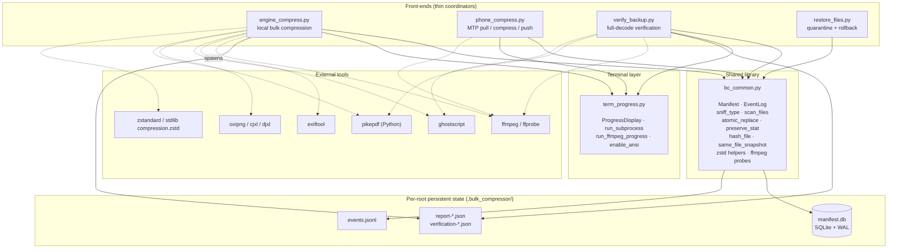

The key architectural property: **all four front-ends are thin coordinators over a shared transactional core**. `bc_common` owns every primitive that could damage data — path scanning, stat snapshots, atomic replacement, hashing, backups — and no front-end mutates files through any other path.

---

## Repository layout

```
bulk-compressor/
├── engine_compress.py      # local bulk compression (primary tool)
├── phone_compress.py       # MTP pull / compress / push pipeline
├── verify_backup.py        # full-decode verification + quarantine
├── restore_files.py        # restore quarantined files, or roll back backups
├── bc_common.py            # shared library: manifest, sniffing, atomic writes
├── term_progress.py        # progress display + cancellation-aware subprocesses
├── test_core.py            # pytest suite (the safety guarantees are the spec)
├── requirements.txt        # Python dependencies
└── README.md
```

Per-target-root state (created automatically):

```
<target>/
├── .bulk_compressor/       # internal state — excluded from scans
│   ├── manifest.db         #   SQLite WAL manifest
│   ├── events.jsonl        #   append-only event log
│   ├── report-*.json       #   compression report (per run)
│   ├── verification-*.json #   verification report (per run)
│   └── orphaned/           #   displaced outputs from rollback
├── _Quarantine/            # failed verification targets (never deleted)
└── _Corrupted_Files/       # legacy quarantine name (excluded from scans)
```

`phone_compress.py` adds a staging area under `~/.cache/phone-compress/`:

```
~/.cache/phone-compress/
├── work/job_<random>/      # per-file staging directory
│   ├── orig.<ext>          #   pulled original
│   ├── out.<ext>           #   compressed output
│   └── journal.json        #   push transaction record
├── checkpoint-<serial>.jsonl
└── log-<timestamp>.jsonl
```

---

## Requirements

### Minimum

- **Python 3.9+**
- **ffmpeg** and **ffprobe** on `PATH` (video/audio transcode + verify)
- **Pillow** (`pip install Pillow`) — required for every image path

### Optional (auto-detected, disabled if absent)

| Tool | Enables |
|---|---|
| `exiftool` | Exact metadata preservation for video, audio, images |
| `ghostscript` (`gs`/`gswin64c`) | PDF re-encoding at `/ebook`/`/screen`/`/printer` |
| `pikepdf` (Python) | Lossless PDF object-stream optimization (preferred over gs) |
| `oxipng` | Faster PNG optimization than Pillow zlib |
| `cjxl` / `djxl` | Lossless JPEG → JXL transcode + roundtrip verification |
| `zstandard` (Python) or Python 3.14 stdlib `compression.zstd` | `--generic-zstd`, zstd stream verification |
| `blake3` (Python) | Faster hashing (falls back to sha256) |
| NVIDIA NVENC | `hevc_nvenc`, `h264_nvenc`, `av1_nvenc` (probed, not assumed) |
| `gio` + MTP mount | `phone_compress.py` device discovery |

The toolkit **fails gracefully**: if a tool is missing, its corresponding path either falls back (e.g. Pillow zlib for PNG) or records `skip` with an explicit reason. Nothing is ever silently skipped.

---

## Installation

### 1 — Clone

```bash
git clone https://github.com/hacktivist211/bulk-compressor.git
cd bulk-compressor
```

### 2 — Virtual environment

```bash
python -m venv .venv
source .venv/bin/activate          # Windows: .venv\Scripts\activate
```

### 3 — Python dependencies

```bash
python -m pip install -r requirements.txt
python -m pip install pikepdf zstandard blake3   # optional but recommended
```

### 4 — System tools

**Debian/Ubuntu**
```bash
sudo apt install ffmpeg ghostscript libimage-exiftool-perl oxipng libjxl-tools
```

**Fedora**
```bash
sudo dnf install ffmpeg perl-Image-ExifTool ghostscript oxipng libjxl-tools
```

**macOS**
```bash
brew install ffmpeg ghostscript exiftool oxipng jpeg-xl
```

**Windows**
- ffmpeg/ffprobe: [gyan.dev builds](https://www.gyan.dev/ffmpeg/builds/), add `bin/` to `PATH`
- Ghostscript: [official installer](https://www.ghostscript.com/releases/gsdnld.html) (`gswin64c.exe`)
- exiftool: `choco install exiftool`

### 5 — Verify the toolchain

```bash
python - <<'PY'
import shutil
for t in ("ffmpeg", "ffprobe", "exiftool", "gs", "oxipng", "cjxl"):
    print(f"{t:10s}", "OK" if shutil.which(t) else "missing (optional)")
import importlib.util
for m in ("PIL", "pikepdf", "zstandard", "blake3"):
    print(f"{m:10s}", "OK" if importlib.util.find_spec(m) else "missing (optional)")
PY
```

---

## Quick start

```bash
# 1) Inventory + compress in one pass
python engine_compress.py /path/to/media --backup /path/to/backup

# 2) Verify everything decodes
python verify_backup.py /path/to/media --quarantine

# 3) If verification quarantined something you care about:
python restore_files.py /path/to/media --dry-run
python restore_files.py /path/to/media

# 4) If you want to undo the compression (requires --backup on step 1):
python restore_files.py /path/to/media --rollback --dry-run
python restore_files.py /path/to/media --rollback
```

For a first run on irreplaceable data, add `--lossless-only --limit 20` and inspect `.bulk_compressor/report-*.json` before removing them.

---

## Tool reference

### `engine_compress.py`

The primary tool. Recursively scans a directory, deduplicates byte-identical files, dispatches each supported file to a format-specific handler, and **atomically replaces the original only when the compressed output is strictly smaller and the source snapshot is unchanged**.

```bash
python engine_compress.py DIRECTORY [flags]
```

#### Positional

| Argument | Description |
|---|---|
| `DIRECTORY` | Root of the tree to process (resolved to absolute) |

#### Flags

| Flag | Type | Default | Description |
|---|---|---|---|
| `--config FILE` | path | auto-discovered | Load settings from this JSON file |
| `--save-config` | bool | `False` | Persist the *resolved* settings to the config file and exit |
| `--lossless-only` | bool | `False` | Disable every lossy path — images/video/audio untouched, only lossless ops run |
| `--codec {auto,av1,hevc,h264}` | choice | `auto` | Video codec. `auto` picks HEVC (NVENC) → AV1 (svt) → HEVC (x265) → H.264 based on what's available |
| `--crf INT` | 0–51 | `28` | libx265 CRF |
| `--x264-crf INT` | 0–51 | `22` | libx264 CRF |
| `--av1-crf INT` | 0–63 | `32` | libsvtav1 CRF |
| `--av1-preset` | string | `"5"` | libsvtav1 preset |
| `--cq INT` | 0–51 | `28` | NVENC constant quality |
| `--preset` | string | `"medium"` | libx265/x264 preset |
| `--nvenc-preset` | string | `"p5"` | NVENC preset |
| `--film-grain INT` | 0–15 | `0` | SVT-AV1 film-grain synthesis level (0 disables) |
| `--force-reencode` | bool | `False` | Re-encode video already in the target codec |
| `--cpu-video` | bool | `False` | Disable NVENC, force software encoding |
| `--video-workers INT` | ≥1 | auto | Concurrent video encoders (auto: 3 with NVENC, else `min(2, CPU//3)`) |
| `--jpeg-quality INT` | 1–100 | `82` | JPEG/WebP re-encode quality |
| `--avif` | bool | `False` | Convert JPEG/PNG/BMP/TIFF to AVIF (requires Pillow with AVIF support) |
| `--avif-quality INT` | 1–100 | `60` | AVIF quality |
| `--jxl` | bool | `False` | Losslessly transcode JPEG → JXL (requires `cjxl`) |
| `--audio-codec {aac,opus}` | choice | `aac` | Lossy audio target |
| `--audio-bitrate` | string | `"128k"` | Lossy audio bitrate |
| `--pdf-settings {/ebook,/screen,/printer}` | choice | `/ebook` | Ghostscript PDF profile |
| `--generic-zstd` | bool | `False` | Compress non-media files to `.zst` (explicit opt-in) |
| `--zstd-level INT` | 1–22 | `10` | zstd level |
| `--deep-verify` | bool | `False` | Pixel/PCM/hash-exact verification of lossless outputs *before* replacement |
| `--vmaf-samples INT` | 0–100 | `2` | Sampled VMAF quality gate for lossy video, `0` disables |
| `--vmaf-threshold FLOAT` | 0–100 | `90.0` | Reject video whose sampled VMAF falls below this |
| `--skip-dedup` | bool | `False` | Skip the duplicate-detection hashing pass |
| `--backup DIR` | path | `None` | Keep every replaced original under `DIR`, enabling `restore_files.py --rollback` |
| `--limit INT` | ≥1 | `None` | Process only the first N pending files |
| `--no-progress` | bool | `False` | Disable the live TUI (falls back to periodic plain output) |

#### Examples

**Conservative first run (backup everything, lossless only)**

```bash
python engine_compress.py /data/media \
    --backup /data/media-backup \
    --lossless-only \
    --deep-verify
```

**Aggressive GPU-first video + AVIF + VMAF gate at 92**

```bash
python engine_compress.py /data/media \
    --backup /data/media-backup \
    --codec hevc --cq 30 \
    --avif --avif-quality 55 \
    --vmaf-samples 4 --vmaf-threshold 92
```

**CPU-only, deterministic, no GPU dependency**

```bash
python engine_compress.py /data/media --cpu-video --codec av1 --av1-crf 34 --preset 6
```

**Persist settings for future runs**

```bash
python engine_compress.py /data/media --save-config \
    --backup /data/media-backup --vmaf-threshold 92 --codec hevc
# resolves to ./config.json; next run loads it automatically
```

#### What a run prints

```
config             : /repo/config.json
files discovered   : 14821 (3 symlinks skipped)
duplicates skipped : 41
to process         : 14537 (214.3 GiB)
mode               : lossy (default)
video encoder      : hevc_nvenc preset p5 cq 28 (NVENC)
quality gate       : VMAF 2 samples at 90.0
video workers      : 3   fast workers: 15
tools              : exiftool=yes oxipng=yes cjxl=yes pikepdf=yes ghostscript=yes zstd=zstandard
...
COMPRESSION COMPLETE
  results recorded  : 14537
  replaced          : 9142
  skipped           : 4831
  kept              : 402
  duplicate         : 41
  error             : 121
  bytes saved       : 41.2 GiB
```

---

### `phone_compress.py`

Pulls media from an Android phone over **MTP** (via GVFS `mtp://` mounts or a `--mount-root`), compresses on the PC, and pushes the result back to the exact same path — as a **journaled transaction with crash recovery**.

```bash
python phone_compress.py PATH [PATH ...] [flags]
```

#### Positional

| Argument | Description |
|---|---|
| `PATH` (one or more) | `mtp:/Device/Storage/DCIM/` URI, storage-relative path (`DCIM`), or absolute path under the mount |

#### Flags

| Flag | Type | Default | Description |
|---|---|---|---|
| `--device`, `--serial` | string | `None` | Substring of the mount name when multiple devices are attached |
| `--storage` | string | `None` | Substring of the storage name when the phone exposes more than one |
| `--mount-root DIR` | path | `None` | Use an already-mounted root (jmtpfs, simple-mtpfs) instead of GVFS |
| `--work-dir DIR` | path | `~/.cache/phone-compress/work` | Staging directory |
| `--backup DIR` | path | `None` | Keep every replaced phone original under `DIR` (hash-verified) |
| `--dry-run` | bool | `False` | Pull + compress, but never modify the phone |
| `--limit INT` | ≥1 | `None` | Process only the first N candidates |
| `--quality INT` | 1–100 | `82` | JPEG/WebP quality |
| `--crf INT` | 0–51 | `28` | libx265 CRF |
| `--preset` | string | `"medium"` | libx265 preset |
| `--cq INT` | 0–51 | `28` | NVENC CQ |
| `--nvenc-preset` | string | `"p5"` | NVENC preset |
| `--cpu` | bool | `False` | Disable NVENC |
| `--force-reencode` | bool | `False` | Re-encode videos already in HEVC |
| `--min-image INT` | bytes | `200000` | Skip images below this size |
| `--min-video INT` | bytes | `1000000` | Skip videos below this size |
| `--min-gain FLOAT` | 0–1 | `0.02` | Minimum fractional saving required to replace |
| `--pull-workers INT` | ≥1 | `2` | Concurrent pull threads |
| `--push-workers INT` | ≥1 | `2` | Concurrent push threads |
| `--image-workers INT` | ≥1 | auto | Image process workers (default `max(2, CPU//2)` or `CPU-2` with GPU) |
| `--video-workers INT` | ≥1 | auto | Video encode workers (default `3` with GPU, else `2`) |
| `--stage-gb FLOAT` | >0 | `8.0` | Maximum originals staged on disk concurrently |
| `--verify-push` | bool | `False` | Read back and hash every pushed file |
| `--max-io-errors INT` | ≥1 | `8` | Consecutive I/O failures before the run stops (disconnect detection) |
| `--no-progress` | bool | `False` | Disable the live TUI |

#### What gets skipped

- Extensions outside `.jpg .jpeg .png .webp .mp4 .mov .3gp .m4v .mkv`
- Already-efficient extensions: `.heic .heif .avif`
- `SKIP_DIRS = {Android, LOST.DIR, .thumbnails, .trashed, _Quarantine}` and dotfiles
- Symlinks
- Motion-Photo / Ultra-HDR images (marker scan of first/last 4 MiB)

#### Example

```bash
python phone_compress.py mtp:/Pixel/Internal\ storage/DCIM \
    --backup ~/phone-backup \
    --verify-push \
    --video-workers 2 \
    --limit 100
```

#### Recovery on the next run

If a run is interrupted (crash, unplug, `Ctrl-C`), the next invocation calls `recover_leftovers()` before doing anything else. Each `job_*/` directory is triaged by the **most conservative** branch that applies:

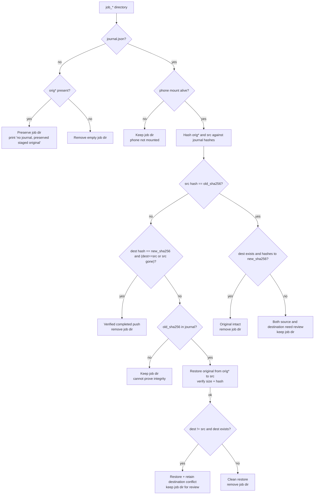

**Size alone is never trusted.** A legacy journal with `old`/`new` but no hashes is *always* preserved, not cleaned.

---

### `verify_backup.py`

Non-destructive integrity verification. **Full decode**, not just file-existence.

```bash
python verify_backup.py DIRECTORY [flags]
```

| Flag | Type | Default | Description |
|---|---|---|---|
| `--fast` | bool | `False` | Structural probe only — skip the full decode |
| `--quarantine` | bool | `False` | Move failing files into `_Quarantine/`, preserving their directory tree |
| `--video-workers INT` | ≥1 | `2` | Concurrent video-decode workers |
| `--workers INT` | ≥1 | `max(2, CPU - video_workers)` | Concurrent fast workers |
| `--no-progress` | bool | `False` | Disable the live TUI |

#### What each family runs

| Family | Operation |
|---|---|
| **Image** | `PIL.Image.open` → dimension check → `im.load()` (forces full pixel decode) |
| **Video** | `ffprobe` (stream + duration + codec) → `ffmpeg -v error -xerror -i FILE -f null -` with live progress |
| **Audio** | `ffprobe` (stream check) → `ffmpeg -xerror` full decode |
| **PDF** | `pikepdf.open` + page count (preferred) → falls back to Ghostscript nullpage render |
| **zstd** | `zstd_check` — decompress the stream |

#### Verdicts

| Verdict | Meaning |
|---|---|
| `ok` | Decoded cleanly |
| `fail` | Decode failed → quarantined if `--quarantine` |
| `skip` | Not verifiable (missing engine, wrong type, or **file changed during verification**) |

**Race guard.** Before quarantining a `fail`, `verify_file` re-runs `same_file_snapshot`. If the file changed mid-verification, the verdict is downgraded to `skip` and the file is left in place. This is tested by `test_verifier_does_not_quarantine_a_file_changed_during_verification`.

#### Example

```bash
python verify_backup.py /data/media --quarantine --video-workers 4
```

Output:

```
VERIFICATION COMPLETE
  files        : 14537
  passed       : 14402
  failed       : 12
  skipped      : 123
  quarantined  : 12
  elapsed      : 1:41:18

report   : /data/media/.bulk_compressor/verification-20251022-143000.json
```

---

### `restore_files.py`

Two independent recovery modes, both driven by the manifest.

```bash
python restore_files.py DIRECTORY [--dry-run] [--rollback]
```

| Flag | Type | Description |
|---|---|---|
| `--dry-run` | bool | Print the plan, change nothing |
| `--rollback` | bool | Restore from backups recorded during `engine_compress.py --backup`, instead of restoring quarantine |

#### `restore_quarantine` (default)

Moves files from `_Quarantine/` back to their original paths recorded in the `quarantine` table. Path containment is enforced on **both** source and target:

- `target` must be inside the restore root
- `source` must be inside `<root>/_Quarantine`
- On collision, **both files are left untouched** and `[collision]` is reported

#### `rollback_replacements` (`--rollback`)

Reverses compression using the `backup_path` / `backup_hash` columns:

- Rejects a backup whose **size ≠ recorded original_size**
- Rejects a backup whose **hash ≠ recorded backup_hash** (blake3 or sha256 as recorded)
- Copies through a temp file, size-checks, `preserve_stat`, then `atomic_replace`
- If the file was renamed during compression (e.g. `.jpg → .avif`), the **compressed output is moved** to `.bulk_compressor/orphaned/` — never deleted
- Marks the manifest row `rolled_back`, so a rollback is auditable

Corrupt backups are **refused** — the compressed file stays where it is. Tested by `test_rollback_refuses_corrupt_backup`.

#### Example

```bash
python restore_files.py /data/media --rollback --dry-run
python restore_files.py /data/media --rollback
```

```
[plan] /data/media-backup/photos/a.jpg -> /data/media/photos/a.jpg
[rolled back] /data/media/photos/a.jpg

rolled back : 1
missing     : 0
```

---

## Configuration file

`engine_compress.py` accepts a JSON config. Discovery order:

1. `--config FILE`
2. `$BULK_COMPRESSOR_CONFIG`
3. `./config.json` (next to the script)
4. `~/.config/bulk-compressor/config.json` (POSIX) or `%APPDATA%\bulk-compressor\config.json` (Windows)

Unknown keys are warned about and ignored. Bad values are warned about and replaced with defaults — **never** silently accepted.

```json
{
  "lossless_only": false,
  "codec": "auto",
  "av1_crf": 32,
  "av1_preset": "5",
  "crf": 28,
  "x264_crf": 22,
  "preset": "medium",
  "cq": 28,
  "nvenc_preset": "p5",
  "film_grain": 0,
  "force_reencode": false,
  "cpu_video": false,
  "video_workers": null,
  "jpeg_quality": 82,
  "avif": false,
  "avif_quality": 60,
  "jxl": false,
  "audio_codec": "aac",
  "audio_bitrate": "128k",
  "pdf_settings": "/ebook",
  "generic_zstd": false,
  "zstd_level": 10,
  "deep_verify": false,
  "vmaf_samples": 2,
  "vmaf_threshold": 90.0,
  "skip_dedup": false,
  "backup": "/data/media-backup"
}
```

### Resolution pipeline

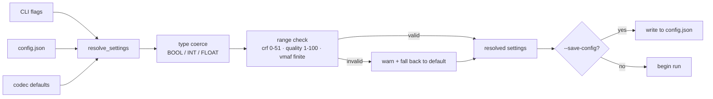

---

## Format support matrix

| Family | Detected kinds | Behavior (default) |
|---|---|---|
| **JPEG** | `jpeg` | Re-encode at `jpeg_quality`, progressive + optimize, exiftool for EXIF, snapshot CAS |
| **PNG** | `png` | `oxipng -o 6` if available, else Pillow `zlib -9` |
| **WebP** | `webp` | Re-encode at `jpeg_quality`, method 6, EXIF preserved |
| **GIF** | `gif` | Static GIF → PNG (lossless). Animated GIF → palette-optimized re-encode *only if* `lossy` |
| **BMP** | `bmp` | → PNG, replace only if smaller |
| **TIFF** | `tiff` | LZW re-compress |
| **AVIF (input)** | `avif` | **Left untouched** |
| **HEIC (input)** | `heic` | **Left untouched** |
| **JXL (input)** | `jxl` | **Left untouched** |
| **JPEG (transcode)** | `jpeg` + `--jxl` | Lossless JPEG → JXL via `cjxl`; optional `djxl` roundtrip with `--deep-verify` |
| **Video** | `mp4`, `mkv`, `avi`, `ts`, `mpeg`, `flv` | HEVC / H.264 / AV1 (NVENC or software), VMAF gate, audio passthrough if AAC |
| **Audio (lossless src)** | `wav`, `aiff` | → FLAC level 8, optional PCM-equality check |
| **Audio (lossy src)** | `mp3`, `amr`, `ogg`, `flac` (already-lossless), `m4a`, `aac` | → AAC (or Opus), with speech heuristic (32 kbps mono for `recording`/`call`/`voice`/`memo`) |
| **PDF** | `pdf` | pikepdf object streams (lossless) + Ghostscript `/ebook` — smallest valid candidate wins |
| **Archives** | `zip`, `gzip`, `xz`, `zstd`, `bzip2`, `7z`, `rar` | **Skipped** (already compressed) |
| **Generic** | `text`, `binary`, `sqlite`, `elf`, `exe` | Only with `--generic-zstd`; refuses if 1 MiB probe fails to compress below 0.99 ratio |

### Explicitly preserved (never processed)

- **1–3 second videos** — possible Live Photo / motion-photo components. `deletion is permanently disabled`
- Multi-frame images (APNG, animated WebP, multi-page TIFF, animated GIF with `lossless_only`)
- Hard-linked files (`st_nlink > 1`)
- Symlinks
- Empty files (recorded `skipped`, never modified)
- `_Quarantine/`, `_Corrupted_Files/`, `.bulk_compressor/`, dotfiles

---

## Internal state & data model

Everything is stored in `<root>/.bulk_compressor/manifest.db` (SQLite, WAL mode, thread-safe via a `threading.Lock`).

### `manifest.db` schema

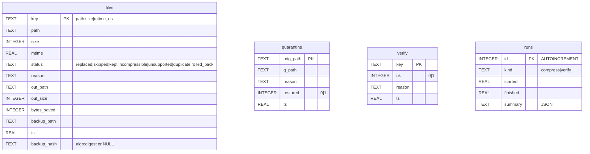

### File status state machine (`files.status`)

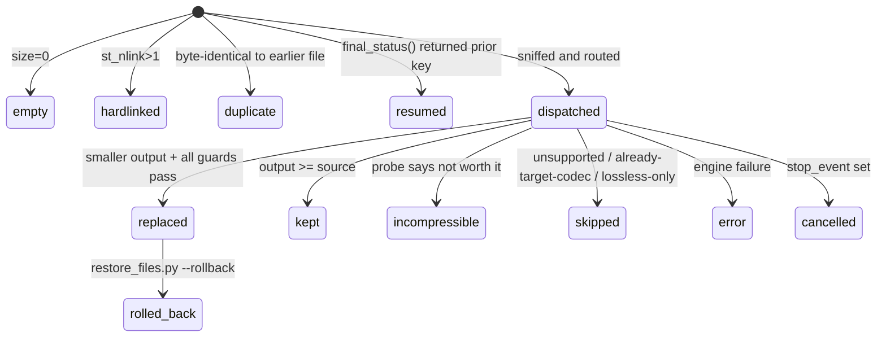

`FINAL_STATUSES = ("replaced", "skipped", "kept", "incompressible", "unsupported", "duplicate", "rolled_back")` — anything in this set marks the file's `key` as processed and prevents reprocessing on resume. `resumed` and `cancelled` are **not** final.

### `events.jsonl`

Append-only, one JSON record per line, guarded by a `threading.Lock`. Every status change is logged here:

```json
{"ts": 1729600000.123, "event": "replaced", "path": "/data/a.jpg", "out": "/data/a.jpg", "saved": 4201, "label": "jpeg q82"}
{"ts": 1729600001.456, "event": "verify_fail", "path": "/data/b.mp4", "note": "decode failed"}
```

### `report-*.json` / `verification-*.json`

Human- and tool-readable summaries written per run. Include settings, encoder, per-file results, counts, and `interrupted` status.

---

## Safety invariants in detail

### `finalize()` — the only path that can replace a file

Every local replacement goes through this function. It is intentionally paranoid:

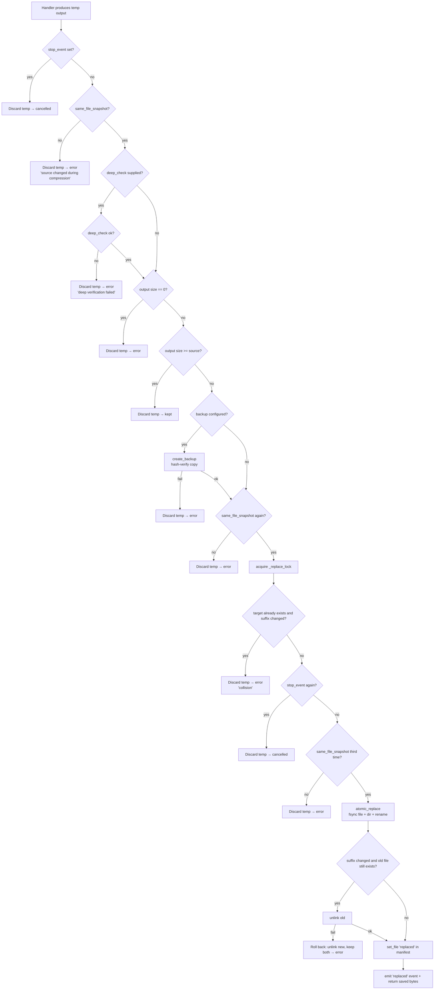

**Three separate `same_file_snapshot` checks** — before the deep check, after the backup, and immediately before the `os.replace`. The last one closes the window between "we decided to replace" and "we replaced."

**`_replace_lock` is global to the process.** Two threads encoding `same.jpg` and `same.png` to `same.avif` will produce exactly one `replaced` and one `error` — never two files at the same path, never a silent overwrite. Tested by `test_finalize_serializes_colliding_output_paths`.

### `create_backup()` — hash-verified at write time

```
hash(source) = T
if backup exists and hash(backup) == T: return backup
target = backup OR backup.mtimeNs.size.backup OR backup.mtimeNs.size.N.backup
tmp = make_tmp(backup.parent)
copy source → tmp
assert same_file_snapshot(source, st)      # source didn't change during copy
assert hash(tmp) == T                       # copy is byte-exact
preserve_stat(source_stat, tmp)
atomic_replace(tmp, target)
```

If any assert fails, the temp file is deleted and the operation errors out. The original is never touched. Tested by `test_finalize_backup_hash_and_rollback_roundtrip`.

### Atomic durable replace

`atomic_replace()` does, in order:

1. `chmod` temp to `|S_IWUSR` so the fsync can succeed
2. `open(tmp, "rb+")` → `flush()` → `fsync(fileno)`
3. restore original mode
4. `os.replace(tmp, dst)` — atomic on the same filesystem
5. `fsync` the **parent directory** so the rename itself is durable

A crash at any point leaves either the intact original or the fully-written new file. Never a half-file. Temp files use `TMP_PREFIX = ".bctmp_"` and are swept at the start of every run by `sweep_temp_files()`.

### Path containment (restore/rollback)

`restore_files.py` resolves every path with `strict=False` and refuses to operate outside:

- `target` must be **inside** `root`
- quarantine `source` must be **inside** `root/_Quarantine`
- rollback `output` must be **inside** `root`

This blocks `../` traversal through a manipulated manifest.

---

## Concurrency model

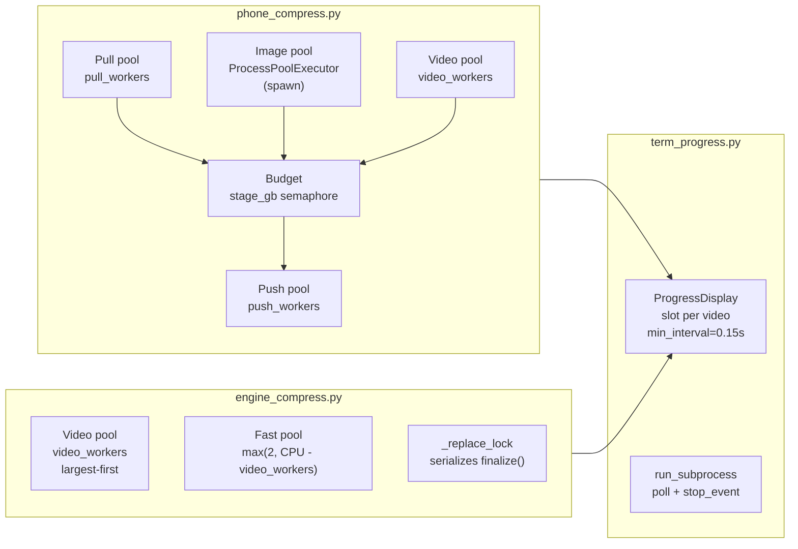

### `engine_compress.py`

- **Two pools** — video work is isolated because FFmpeg encoding is ~2 orders of magnitude heavier than image work. A directory of 500 videos cannot starve image processing.
- **Process pool for Pillow** (`phone_compress` only) — image encode is CPU-bound and GIL-limited, so `ProcessPoolExecutor(mp_context=spawn)` is used. Videos stay on threads because `ffmpeg` is a subprocess.
- **Global `_replace_lock`** — only `finalize()`'s critical section (target existence check + `os.replace` + old-file removal) is serialized. Encoders run fully in parallel.
- **`stop_event`** — plumbed through `run_ffmpeg_progress` and `run_subprocess`, so `Ctrl-C` terminates child processes cleanly (SIGTERM → 5 s wait → SIGKILL) rather than orphaning them.

### `phone_compress.py` extras

- **`Budget`** — a `threading.Condition` gates total staged bytes. `stage_pull` acquires `t.size` before copying and `finish` releases it. This prevents staging 500 videos (and filling the disk) when only `--stage-gb` bytes should exist on the PC at once.
- **`Checkpoint`** — append-only JSONL of `key` / `out_key`. Loaded at startup; each completed file is appended and `flush()`ed. A crash never loses completed-work records.
- **`outstanding` counter + `Condition`** — `wait_all()` blocks until every task has called `finish()`, including workers that errored. No "silent thread failure" window.
- **`io_streak` counter** — `--max-io-errors` consecutive `ioerror` results set `C.disconnected` and stop the run. Partial state is consistent, and the next run recovers via `recover_leftovers`.

### `term_progress.ProgressDisplay`

- **TTY mode**: redraws in place with ANSI cursor up + `\x1b[K` clear. `lines_drawn` tracks exactly how many lines to move up. Per-video slots (`claim_slot` / `update_slot` / `release_slot`) give each active encoder its own progress bar.
- **Non-TTY mode**: periodic plain lines every 10 s, one `stdout.write` per line. No ANSI.
- **Frame limiting**: `min_interval = 0.15` s prevents redraw storms from `ffmpeg -progress`'s high-frequency output.

---

## End-to-end workflow diagrams

### Full local pipeline

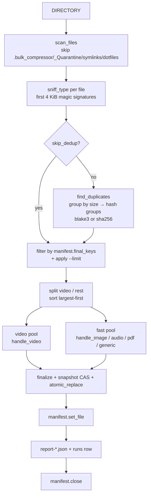

### Handler dispatch

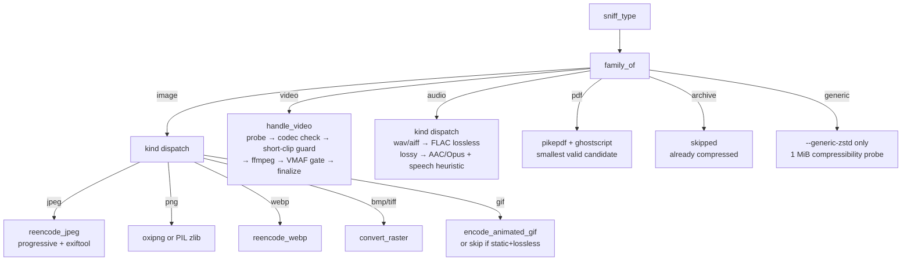

### Verification + quarantine

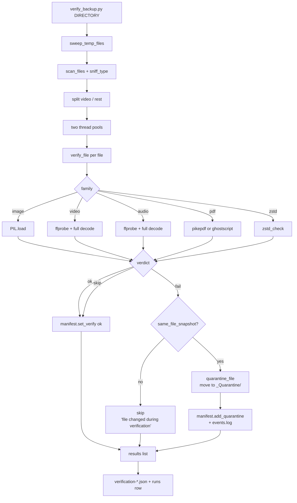

### Rollback

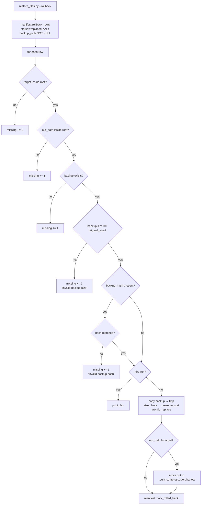

---

## Troubleshooting

### `ffmpeg not found` / `ffprobe failed`

Install ffmpeg + ffprobe and confirm both are on `PATH`:

```bash
ffmpeg -version && ffprobe -version
```

### `Pillow is required`

```bash
python -m pip install Pillow
```

The tool exits with a clear error before touching anything.

### `pikepdf not installed; lossless PDF optimization unavailable`

Optional. Lossy PDF via Ghostscript still works. For lossless optimization:

```bash
python -m pip install pikepdf
```

### `NVENC unavailable` / encode falls back to CPU unexpectedly

NVENC is **probed, not assumed**. A short encode is attempted; if it fails, the tool falls back. To force CPU:

```bash
python engine_compress.py /data/media --cpu-video
```

### `only N free under work dir` (phone_compress)

Reduce `--stage-gb` or free disk space. Staging caps total bytes in flight.

### `repeated I/O failures, phone likely disconnected`

The run stopped at `--max-io-errors` (default 8). Reconnect the phone and re-run — the `Checkpoint` and `recover_leftovers` will resume.

### `cannot prove recovery copy integrity; kept ...`

A `job_*/` directory was preserved because identity could not be proven (legacy journal, no hashes, or source/dest both ambiguous). **Inspect it manually** — this is the conservative branch by design. It is not an error; it is the tool refusing to guess.

### Verifier reports `skip` with `file changed during verification`

The file was modified between `stat` and the decode. It's **not** quarantined. Re-run verification.

### A file was replaced but you want the original back

- If you ran with `--backup DIR`, use `restore_files.py DIRECTORY --rollback`.
- Without `--backup`, the original is gone — this is why `--backup` is strongly recommended.

### Rollback reports `[invalid backup] hash mismatch`

The backup file on disk no longer matches what was recorded at compression time. The compressed file is **not** touched. Investigate the backup directory for bit rot, a partial copy, or a mount that lost data.

---

## Limitations & non-goals

### Intentionally out of scope

| Not done | Why |
|---|---|
| **HEIC / AVIF / JXL input re-encoding** | Already efficient; re-encoding cannot help and risks quality loss |
| **Archive re-compression** (`zip`, `7z`, `xz`, `bzip2`, `rar`) | Already compressed — output would be larger |
| **Office documents** (`.docx`, `.xlsx`, `.pptx`) | Container formats; re-zipping is not worth the metadata risk. Detected, skipped, reported |
| **Permanent checksum manifest** | The `manifest.db` rows are the record; a separate sign-off file was considered and rejected as scope creep. Verify with `verify_backup.py` instead |
| **Post-compression "did the whole run succeed" audit** | Every file's status is in `manifest.db`; the report mirrors it. No separate audit step |

### Architectural limits

- **Same-filesystem assumption** for `os.replace` — temp files are always created in the **target directory**, so this holds
- **Per-root state** — moving files out of a processed tree orphans their manifest rows
- **`file_key` uses `mtime_ns`** — a `touch` alone treats a file as new (deliberate: a touched file may have been rewritten)
- **SQLite under the target** — the tool cannot operate read-only on a target volume
- **MTP** requires `gio` and a mounted device; **PTP/iPhone** is explicitly rejected (`'PTP/iPhone devices are not supported'`)

### Not implemented (but sometimes requested)

- `--dry-run` on `engine_compress.py` (use `--lossless-only --limit N` and inspect the report)
- Automatic backup destination (must be set with `--backup`)
- AV1 on CPU when the ffmpeg build lacks `libsvtav1` (falls back to HEVC, logs a warning)
- Persistent checkpoint file for `engine_compress.py` — the manifest **is** the checkpoint

---

## Development & testing

The test suite (`test_core.py`) is effectively the specification of the safety guarantees. It covers:

- signature sniffing, scan exclusions, snapshot detection
- `finalize` smaller-only replacement + readonly-mode preservation
- `finalize` refusal when the source changed
- backup → rollback roundtrip and **corrupt-backup refusal**
- manifest migration for the `backup_hash` column
- subprocess cancellation
- phone recovery: **size alone is never trusted**, only verified completed outputs are cleaned
- legacy journals are preserved
- a job with only a staged original is preserved
- out-of-range settings fall back to defaults
- colliding output paths are serialized
- nested phone targets dedupe
- the verifier does **not** quarantine a file modified during verification

Run:

```bash
python -m pip install pytest
pytest -q test_core.py
```

### Design notes

- **Standard-library only** — `threading`, `concurrent.futures`, `subprocess`, `pathlib`, `hashlib`, `sqlite3`. No async framework, no task queue.
- **Native tools do the heavy lifting** — ffmpeg, Pillow codecs, Ghostscript, oxipng, cjxl. Python owns orchestration, scheduling, filesystem policy, reporting, and recovery.
- **Every handler returns `(status, note, saved)`** — the manifest is written from that tuple, not from scattered `manifest.set_file` calls. This keeps status reporting consistent.
- **Every guard has a test.** If you change `finalize()` or `recover_leftovers()`, expect a test to catch you.

### Extending

Adding a format means:

1. Add the magic signature to `sniff_type()`
2. Add the kind → family mapping to `FAMILIES`
3. Add a `handle_*` branch in `process_file()`
4. The handler must produce a temp output and call `finalize(ctx, path, st, tmp, out_ext, label, deep_check)`
5. If it's lossy, add an option in `DEFAULTS` and the config-resolution range check

---

## License

No license is asserted by the source files. Add the repository's actual license here when selected.

---

## Repository

**https://github.com/hacktivist211/bulk-compressor/**

When reporting a bug, include:

- OS + Python version
- `ffmpeg -version` and `ffprobe -version`
- Ghostscript version (if PDFs involved)
- exact command run
- affected file format
- relevant excerpt from `.bulk_compressor/report-*.json` or `.bulk_compressor/events.jsonl`
- for phone issues: the `journal.json` from the affected `job_*/` directory (redact paths)
